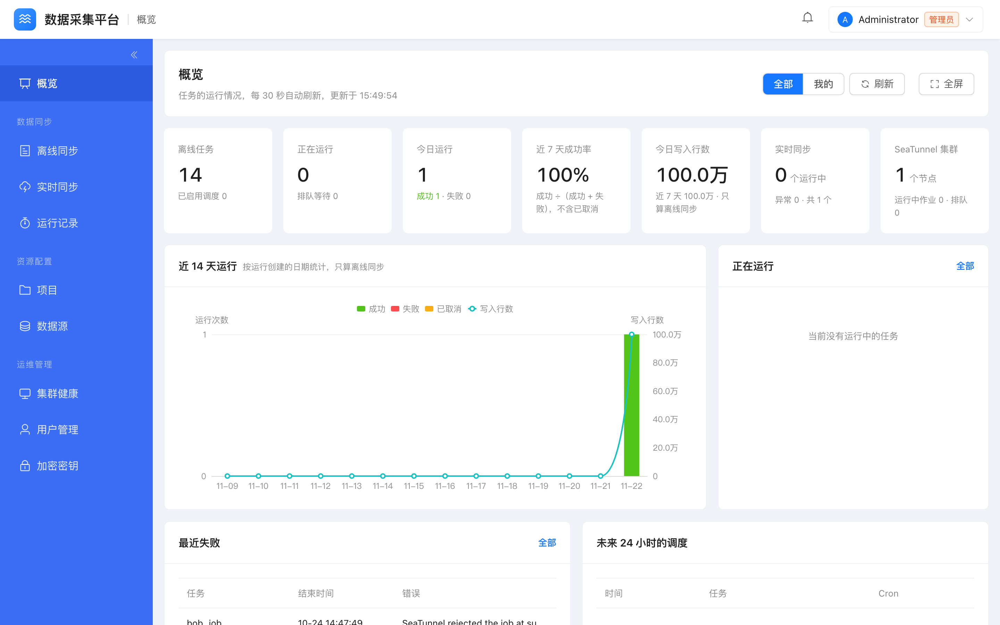
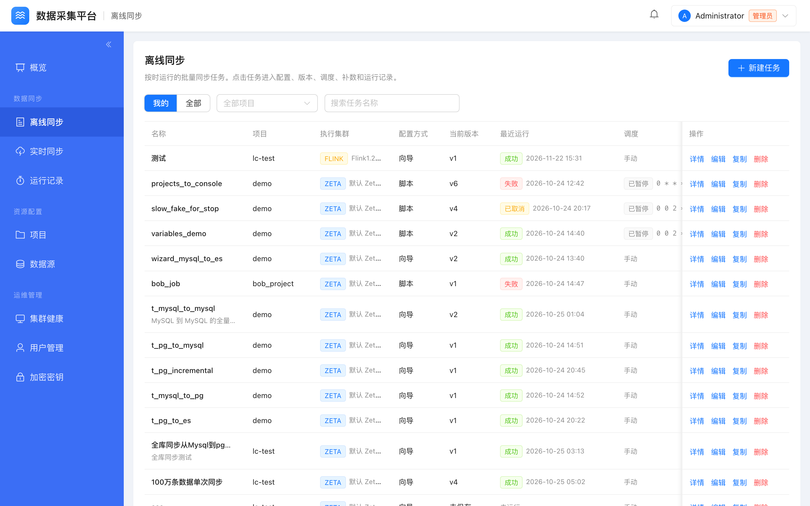
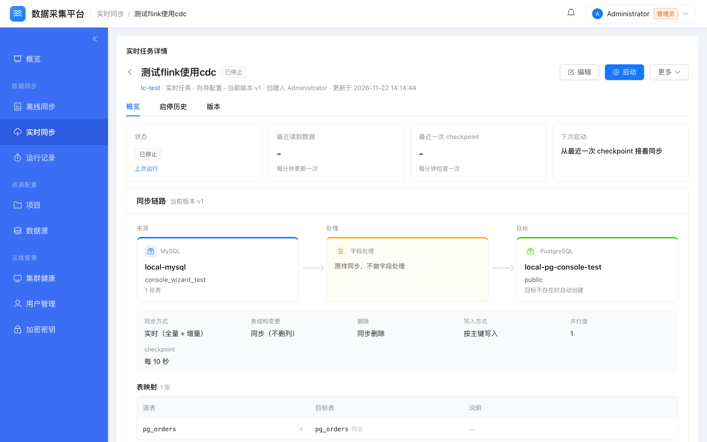
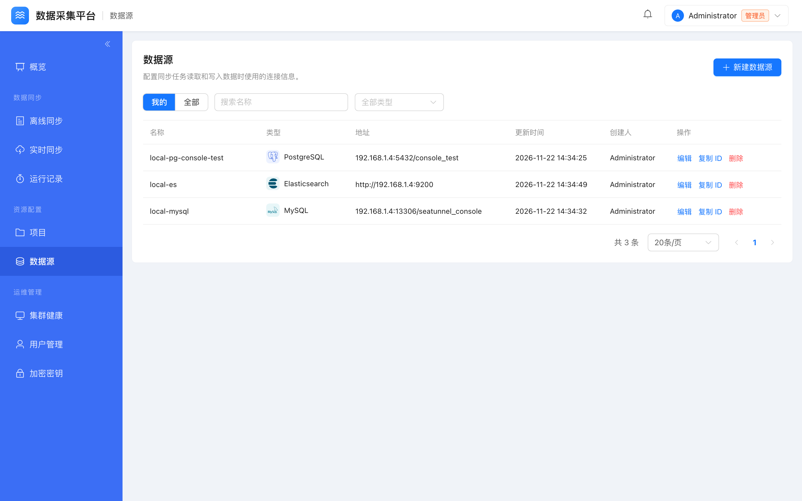
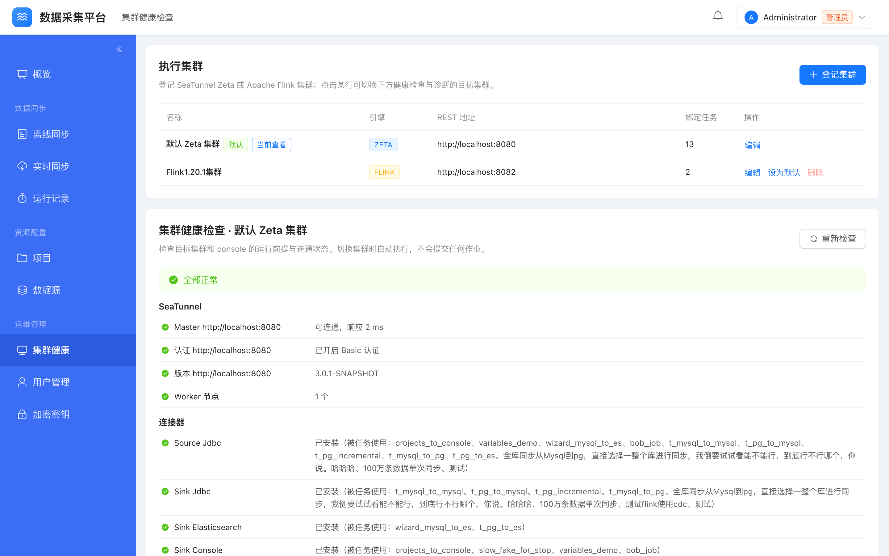
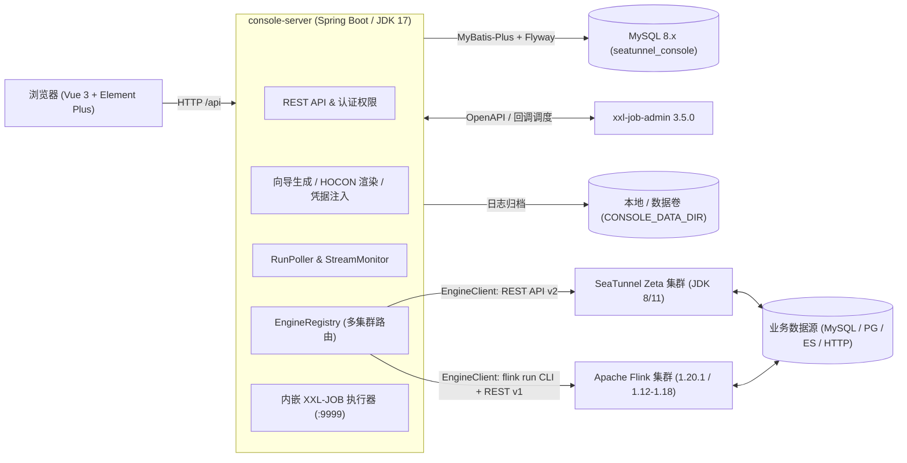

# seatunnel-console

面向 Apache SeaTunnel 的数据集成管理平台，覆盖离线同步、实时 CDC 同步、多集群/多引擎调度与可观测运维。详细设计见 [docs/design.md](docs/design.md)、数据库表结构见 [docs/schema.md](docs/schema.md)、Flink 引擎接入见 [docs/flink-spark.md](docs/flink-spark.md)。

---

## 系统概览

`seatunnel-console` 提供从数据源接入、任务编排、调度补数到实时监控的一站式数据同步管理体验：

- **离线同步**：支持五步可视化向导（表映射、字段裁剪/脱敏/类型转换/加密、连续增量水位、并行度与校验）与 HOCON 脚本双模式，内置变量表达式、版本管理、Cron 调度、重跑、批量补数及行数校验。
- **实时同步（CDC）**：支持 MySQL-CDC / PostgreSQL-CDC → MySQL / PostgreSQL / Elasticsearch，具备前置条件检查、表结构变更跟随、Checkpoint 监控、带 Savepoint 停止与断点恢复、异常自动重启。
- **多引擎与多集群**：统一纳管多个 SeaTunnel Zeta 集群与 Apache Flink 集群，按任务绑定目标集群，支持跨引擎向导任务复制与自动配置转换。
- **可观测与运维**：概览大屏（支持全屏投屏）、任务级吞吐曲线与事件时间线、引擎作业日志归档、集群健康巡检与一键诊断、站内消息中心。
- **安全与权限**：账号体系与资源归属隔离、人员离职资源整体移交、数据源凭据与字段加密密钥全链路加密存储与内存注入。

### 界面预览

#### 1. 概览大屏

展示全局 / 个人维度的任务总数、当日运行与写入行数、近 7 天成功率、近 14 天运行趋势、正在运行及最近失败的任务，以及未来 24 小时调度预览（支持一键全屏展示）。



#### 2. 离线同步任务

按项目与引擎（`ZETA` / `FLINK`）集中管理离线任务，支持向导与脚本两种配置方式、多版本追溯、调度启停、复制与批量补数。



#### 3. 实时同步与链路详情

可视化展示 CDC 实时任务的同步链路（来源 → 字段处理 → 目标）、同步模式、表结构变更策略、Checkpoint 周期、表映射与实时运行指标。



#### 4. 数据源管理

统一维护 MySQL、PostgreSQL、Elasticsearch 等数据源，支持保存前连通性测试、按需引用 `datasource_id`，连接密码加密存储、运行时注入。



#### 5. 多集群管理与健康检查

支持同时登记多个 SeaTunnel Zeta 集群与 Apache Flink 集群，一键切换巡检各集群节点状态、认证配置、已安装连接器及端到端运行诊断。



---

## 架构说明

### 整体架构



### 工程模块

```text
seatunnel-console/
├── console-common       通用返回结构 Result、ConsoleException、错误码与公共工具
├── console-engine       EngineClient 抽象接口；ZetaRestClient（Zeta REST API v2）
│                        与 FlinkEngineClient（flink run CLI + Flink REST API v1）
├── console-datasource   数据源插件抽象与元数据探测（MySQL / PostgreSQL / Elasticsearch / HTTP）
├── console-server       Spring Boot 应用：HTTP API、持久化（MyBatis-Plus + Flyway）、
│                        集群登记与路由（cluster）、离线执行与补数（run）、实时监控（stream）、
│                        内嵌 XXL-JOB 执行器（seatunnelJobHandler）与调度客户端（scheduler）
├── console-ui           Vue 3 + Vite + Element Plus 前端工程
├── docker/              docker-compose（MySQL、xxl-job-admin、console）与 MySQL 初始化脚本
└── Dockerfile           多阶段构建：先构建前端静态资源，再打入 console-server 可执行 jar
```

### 核心设计机制

1. **零引擎 Jar 依赖与双引擎路由**
   - `console` 不引入任何 SeaTunnel 或 Flink 的 Java 依赖，因此 `console`（JDK 17）与底层执行引擎（JDK 8/11）版本完全解耦。
   - 所有执行交互收敛在 `console-engine` 的 `EngineClient` 接口：`ZetaRestClient` 通过 Zeta REST API v2 提交、监控与停止作业；`FlinkEngineClient` 通过提交端本机 `flink run -d` 提交作业，并通过 Flink REST API v1 查询指标、Checkpoint、异常、日志及触发 Savepoint。
   - `EngineRegistry` 按每个任务绑定的 `cluster_id` 动态获取对应的 `EngineClient` 实例，支持同平台下多套 Zeta / Flink 集群并行运行。

2. **凭据加密与运行时内存注入**
   - 数据源密码、集群认证凭据与字段加密密钥均采用 AES-256-GCM（由环境变量 `CONSOLE_SECRET_KEY` 派生）加密持久化。
   - 任务 HOCON 配置中仅保存 `datasource_id` 和密钥 ID；作业提交前由服务端在内存中完成变量渲染与凭据注入，不落盘明文、不在前端或接口回显密码。

3. **调度、单实例保护与状态追踪**
   - 离线任务通过内嵌的 XXL-JOB 执行器（`seatunnelJobHandler`）触发，支持 Cron 调度、失败重试、超时控制、阻塞策略、连续增量水位推进、批量补数及源目行数校验；运行期间由轮询器采集读写行数与吞吐曲线，结束后自动归档作业日志。
   - 实时任务由 `StreamMonitor` 持续采样吞吐指标与 Checkpoint 外部路径，支持带 Savepoint 优雅停止、从 Savepoint / Checkpoint 断点续传、异常自动重启及删除任务时的清理收尾。

---

## 依赖与版本

| 软件 | 版本 | 用途 | 获取方式 |
|---|---|---|---|
| JDK | **17** | 编译和运行 console | 任意发行版（Temurin、Oracle 等） |
| Maven | 3.9+ | 编译后端 | 官网下载 |
| Node.js | **20.19+ 或 22.12+**（Vite 8 的要求） | 编译前端 | 官网下载 |
| MySQL | 8.x（Docker 部署用的是 8.4） | console 自己的库 `seatunnel_console`、XXL-JOB 的库 `xxl_job` | 自行安装，或用 Docker 部署里的 MySQL |
| xxl-job-admin | **3.5.0**（JDK 17） | 调度 | Docker 镜像 `xuxueli/xxl-job-admin:3.5.0`，或从 [xxl-job](https://github.com/xuxueli/xxl-job) 3.5.0 源码打包 |
| SeaTunnel | **3.0.0**，Zeta 集群模式（JDK 8 或 11，不要用 17） | 执行同步作业（Zeta 引擎） | [官网下载页](https://seatunnel.apache.org/download) 的二进制包 |
| Apache Flink（可选） | **1.20.1**（或 1.12–1.18，**不支持 1.19**），Standalone / Session | 执行同步作业（Flink 引擎）；console 本机另备同版本 Flink 客户端与精简 SeaTunnel 发行包 | [Flink 官网](https://flink.apache.org/downloads/) 或官方镜像 `flink:1.20.1-scala_2.12-java11` |
| JDBC 驱动 | MySQL Connector/J 8.x、PostgreSQL 42.x | 放进 SeaTunnel 的 `lib/` | Maven 中央仓库 |
| Docker / Docker Compose | 较新版本即可 | 只在 Docker 部署时需要 | — |

**SeaTunnel 集群不在本仓库里，也不在 docker-compose 里**，两种部署方式都要先按下面「准备 SeaTunnel 集群」装好。

---

## 快速开始

有两条路线：

- **A. 用 Docker 部署**：MySQL、xxl-job-admin、console 一起起来，建库、建 XXL-JOB 执行器都是自动的。适合试用和交付
- **B. 本地开发**：自己装 MySQL 和 xxl-job-admin，后端用 jar 或 IDE 启动，前端用 Vite 开发服务器

两条路线都先做第 0 步。

### 0. 准备 SeaTunnel 集群（两条路线都需要）

1. 下载并解压 SeaTunnel 3.0.0 二进制包，用 JDK 8 或 11
2. 安装连接器插件：确认 `config/plugin_config` 里包含 `connector-jdbc`、`connector-elasticsearch`、`connector-fake`、`connector-console`（后两个用于"集群健康"页的运行诊断），执行 `bin/install-plugin.sh`，完成后 `connectors/` 下应有这几个 jar
3. 把 MySQL / PostgreSQL 的 JDBC 驱动放进 `lib/`（集群里**每个节点**都要放）
4. 修改 `config/seatunnel.yaml`，打开 REST API v2 和 Basic 认证（console 默认用 `admin` / `admin123`，可以通过 `CONSOLE_ZETA_USERNAME`、`CONSOLE_ZETA_PASSWORD` 修改）：

   ```yaml
   seatunnel:
     engine:
       http:
         enable-http: true
         port: 8080
         enable-basic-auth: true
         basic-auth-username: admin
         basic-auth-password: admin123
   ```

5. 修改 `config/log4j2.properties`：把 `rootLogger.appenderRef.file.ref` 改为 `routingAppender`（**每个节点**都要改），**否则 console 看不到 SeaTunnel 作业日志**
6. 以集群模式启动（`-m local` 模式没有 REST 服务）：

   ```bash
   ./bin/seatunnel-cluster.sh -d
   curl -u admin:admin123 http://localhost:8080/overview     # 返回集群信息即可
   ```

> **Apple Silicon + Oracle JDK 8**：G1 在这个组合下是实验特性，SeaTunnel 默认的 `config/jvm_options` 会报错
> `VM option 'UseG1GC' is experimental`。在 `-XX:+UseG1GC` 之前加一行 `-XX:+UnlockExperimentalVMOptions`，或者改用 JDK 11。

完整的集群要求（多 master、checkpoint 存储、作业过期时间等）见 [docs/design.md](docs/design.md) §4.3。

### A. 用 Docker 部署

`docker/docker-compose.yml` 一次启动 MySQL、xxl-job-admin 和 console（前端已打包进 console 的 jar，镜像在本机构建）。SeaTunnel 集群要先按第 0 步准备好。

```bash
cd docker
cp .env.example .env      # 填写密码、CONSOLE_SECRET_KEY、XXL_JOB_ACCESS_TOKEN、SeaTunnel 地址
docker compose up -d --build
```

- 打开 `http://<主机>:8088`，用 `admin` 和 `.env` 里的 `CONSOLE_ADMIN_PASSWORD` 登录
- `CONSOLE_SECRET_KEY` 要另外备份，丢了已保存的数据源密码就解不开
- MySQL 首次初始化时会自动创建 console 的库和账号，以及 XXL-JOB 的执行器分组 `seatunnel-console`（id 10，带上 `XXL_JOB_ACCESS_TOKEN`），不需要再到 xxl-job-admin 里手动建
- xxl-job-admin 的界面在 8081 端口，默认账号 `admin/123456`，登录后立刻改密码
- **网络**：console 容器要能访问 SeaTunnel 的 REST 端口和各个数据源；SeaTunnel 的 worker 也要能访问数据源。数据源地址要从这两边都能连通，不要写 `127.0.0.1`
- console 的作业日志归档和 XXL-JOB 执行器日志在数据卷 `console-data`、`console-logs` 里
- 部署后打开"集群健康"页检查一遍，再点"运行诊断"

### B. 本地开发

#### 1. 准备 MySQL 和 xxl-job-admin

| 依赖 | 要求 |
|---|---|
| MySQL 8.x | 建库 `seatunnel_console`（`utf8mb4`）和一个对这个库有全部权限的账号，表由 console 启动时通过 Flyway 自动创建，不用手工建表；库 `xxl_job`，导入 `docker/mysql/init/02-xxl-job.sql`（XXL-JOB 3.5.0 官方脚本，脚本里自带建库语句） |
| xxl-job-admin 3.5.0（JDK 17） | 连接上面的 `xxl_job` 库。默认账号 `admin/123456`，登录后要立刻修改密码 |
| xxl-job-admin 中的执行器 | 新建执行器，AppName 填 `seatunnel-console`，注册方式选"自动注册"，再设置一个 AccessToken，并记下这个执行器的 id |

不想从源码打包 xxl-job-admin 的话，可以直接用官方镜像（把数据库地址和密码换成自己的）：

```bash
docker run -d --name xxl-job-admin -p 8081:8080 \
  -e PARAMS="--spring.datasource.url=jdbc:mysql://<MySQL 地址>:3306/xxl_job?useUnicode=true&characterEncoding=UTF-8&serverTimezone=Asia/Shanghai --spring.datasource.username=root --spring.datasource.password=<密码>" \
  xuxueli/xxl-job-admin:3.5.0
```

xxl-job-admin 要能访问到 console 所在机器的 9999 端口（执行器端口）。如果它通过自动识别的 IP 访问不到，就设置 `CONSOLE_XXL_JOB_EXECUTOR_ADDRESS`。

暂时不想接 XXL-JOB 的话，设置 `CONSOLE_XXL_JOB_ENABLED=false` 即可启动。

> `docker/docker-compose.yml` 用来部署和交付整套环境，本地开发用不到它。

#### 2. 编译并启动后端

本地配置放在 `dev.env`：复制模板 `cp dev.env.example dev.env` 再填写（`dev.env` 已加入 .gitignore，里面有数据库密码和 `CONSOLE_SECRET_KEY`）。**`CONSOLE_SECRET_KEY` 丢失后，已保存的数据源密码就无法解密了。**

```bash
mvn -DskipTests install
set -a; source dev.env; set +a
java -jar console-server/target/seatunnel-console.jar     # http://localhost:8088
```

在 IDE 里运行 `ConsoleApplication` 时，把 `dev.env` 配置为环境变量文件。

第一次启动时会创建管理员账号 `admin`。没有设置 `CONSOLE_ADMIN_PASSWORD` 时会随机生成密码，**只在启动日志里打印一次**（日志里搜索 `initial administrator`）。

常用环境变量：

| 变量 | 默认值 |
|---|---|
| `CONSOLE_SECRET_KEY` | 无，**必填**：`openssl rand -base64 32` |
| `CONSOLE_ADMIN_USERNAME` / `CONSOLE_ADMIN_PASSWORD` | `admin` / 随机生成 |
| `CONSOLE_DATA_DIR` | `./data`（SeaTunnel 日志的归档目录） |
| `CONSOLE_DB_URL` / `CONSOLE_DB_USERNAME` / `CONSOLE_DB_PASSWORD` | `jdbc:mysql://localhost:3306/seatunnel_console` / `console` / `console` |
| `CONSOLE_ZETA_MASTER_URLS` | `http://localhost:8080`（多个地址用逗号分隔） |
| `CONSOLE_ZETA_USERNAME` / `CONSOLE_ZETA_PASSWORD` | `admin` / `admin123` |
| `CONSOLE_RUN_POLL_INTERVAL` | `2s`（运行状态及指标采样间隔） |
| `CONSOLE_XXL_JOB_ENABLED` | `true` |
| `CONSOLE_XXL_JOB_ADMIN_ADDRESSES` | `http://localhost:8081`（多个地址用逗号分隔） |
| `CONSOLE_XXL_JOB_APPNAME` / `CONSOLE_XXL_JOB_ACCESS_TOKEN` / `CONSOLE_XXL_JOB_GROUP_ID` | `seatunnel-console` / 空 / `0` |
| `CONSOLE_XXL_JOB_EXECUTOR_PORT` / `CONSOLE_XXL_JOB_EXECUTOR_ADDRESS` | `9999` / 空（自动识别） |

#### 3. 启动前端

```bash
cd console-ui
npm install
npm run dev        # http://localhost:5173，/api 请求代理到 8088
```

#### 4. 验证

浏览器打开 http://localhost:5173 ，用管理员账号登录，再打开"集群健康"页检查 SeaTunnel、XXL-JOB 和数据目录，点"运行诊断"确认作业日志和 JDBC 驱动都正常。也可以用命令检查：

```bash
curl localhost:8088/actuator/health          # {"status":"UP"}；其他接口都要先登录
```

---

## 账号与权限

- 第一次启动自动创建管理员 `admin`。管理员在"用户管理"里新建其他用户并设初始密码，对方首次登录时必须修改
- 所有人都能看到全部内容，但只能修改、删除、运行**自己创建的**项目、数据源和任务（管理员不受限）；任务只能使用创建人自己的数据源
- 有人离职或交接时，管理员在"用户管理"里把他名下的内容整体转给另一个人

---

## 使用流程

1. **项目与数据源**：新建项目后，在「数据源」中创建 MySQL、PostgreSQL 或 Elasticsearch 数据源，测试连接后保存。
2. **离线同步**：在「离线同步」新建任务并选择目标集群与配置方式：
   - **向导模式**：按 来源 → 目标（表映射） → 字段与同步方式（字段裁剪/改名/脱敏/加密、连续增量水位） → 并行度与校验 → 预检查与预览 五步完成配置，可随时转为脚本模式（不可逆）。
   - **脚本模式**：直接编写 HOCON，可一键插入数据源（生成 `datasource_id` 占位）和带中文注释的 Transform 模板，支持变量表达式（`${名称}`、`$[yyyyMMdd-1]`）与渲染预览。
   - **运行、调度与补数**：支持立即运行、实时指标与日志查看、按频率或 Cron 同步至 XXL-JOB 调度、失败重跑、按日期范围批量补数及源目行数校验。
3. **实时同步（CDC）**：在「实时同步」中配置 MySQL-CDC / PostgreSQL-CDC → MySQL / PostgreSQL / Elasticsearch 任务，内置前置 CDC 条件检查、表结构变更跟随、Checkpoint 监控、带 Savepoint 停止与断点恢复。
4. **多集群与 Flink 引擎**：管理员在「运维管理 → 集群健康」登记多个 Zeta 或 Flink 集群（升级时原 `CONSOLE_ZETA_*` 自动导入为默认 Zeta 集群，旧任务自动回填绑定）。新建任务时选择执行集群，跨引擎复制向导任务会自动按目标引擎重新生成配置（详见 [docs/flink-spark.md](docs/flink-spark.md)）。
5. **字段加密与消息中心**：管理员可在「加密密钥」中管理字段加密密钥；顶栏消息铃铛聚合离线失败、实时异常、Checkpoint 告警、补数暂停和集群断连通知。

后续规划：外部告警渠道（Webhook / 钉钉 / 企微）、更多数据源、运行记录/指标采样保留清理策略等（见 [docs/design.md](docs/design.md) §12）。

---

## 测试

```bash
mvn test
```

## 已核实的 Zeta 3.0.0 REST 行为

- `/submit-job` 返回的 `jobId` 是**字符串**（文档示例写的是数字）。jobId 会超出 JavaScript 能精确表示的整数范围，所以前端必须一律按字符串处理。
- 用 `/job-info/{id}` 查询不存在或已过期的任务时，只返回 `{"jobId": "..."}`，没有 `jobStatus` 字段。
- 开启 Basic 认证后，不带认证信息的请求返回 401。
